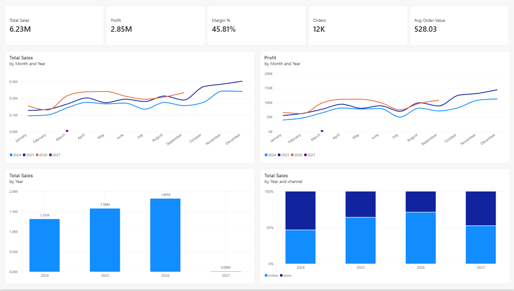

# Retail Sales Analytics: Azure Data Lake, pandas and Power BI

I took a messy, synthetic retail sales dataset, cleaned it in pandas, stored it in an Azure Data Lake and built a four page Power BI dashboard that answers ten business questions.

The full write up is in [docs/FULL_REPORT.md](docs/FULL_REPORT.md).

> All data is synthetic. There are no real customers, companies or transactions.



## The business

Emerald Home & Living is a fictional Irish home and lifestyle retailer. It sells Home Decor, Kitchen, Furniture, Garden, Bedding and Lighting, online and in store, to consumers, small businesses and corporate customers. The data covers January 2024 to September 2026 (2026 is a partial year), with about 11,800 orders, 6,500 customers and 78 products, all in euro.

## What I did

1. **Cleaned** three messy CSV files in pandas (dates, euro text, channel labels, quantities, prices, duplicates, future dates, county names).
2. **Stored** the cleaned files in Azure Data Lake Storage Gen2.
3. **Modelled** the data in Power BI as a star schema, with 17 DAX measures and one calculated column.
4. **Built** a four page dashboard: Performance, Products, Customers and Black Friday.
5. **Wrote** findings and recommendations.

## Tools

Python (pandas), Azure Data Lake Storage Gen2, Power BI Desktop, DAX.

## Key findings

- Higher discounts mean lower margin, and margin is lowest above 30%.
- On Black Friday the average discount went from about 2% to about 12%. Sales went up, margin dropped from about 48% to about 40% and daily profit stayed about the same.
- Furniture has the highest return rate, then Bedding.

## Recommendations

1. Cap normal discounts at around 20% to protect margin.
2. Run a shorter, lighter Black Friday promotion on selected products only.
3. Look into why Furniture and Bedding get returned so much.

## Repository structure

```
.
├── README.md
├── clean.py
├── .gitignore
├── data/
│   ├── raw/          raw_orders.csv, customers.csv, products.csv
│   └── clean/        Orders_cleaned.csv, customers_cleaned.csv, products.csv
├── powerbi/
│   └── SALES_DASHBOARD.pbix
├── screenshots/      6 dashboard and architecture images
└── docs/
    └── FULL_REPORT.md
```

## How to run it

1. The raw CSVs are already in `data/raw/`. Install pandas with `pip install pandas`.
2. From the repo root, run `python clean.py` to create the cleaned files.
3. Open `powerbi/SALES_DASHBOARD.pbix` in Power BI Desktop.
4. If the data source path is different on your machine, go to Transform data, then Data source settings, and point it at `data/clean/`.

## Author

Obedh K Joby, MSc Data Analytics, BTech Information Technology.
