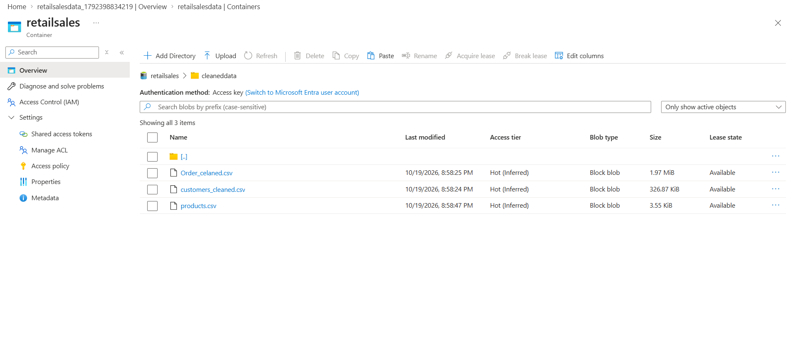
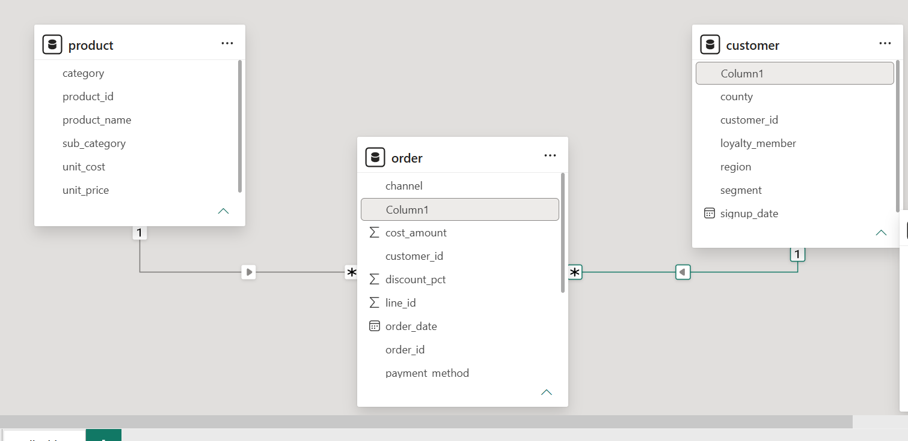
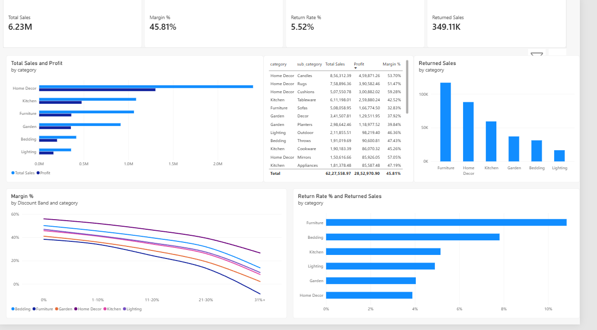
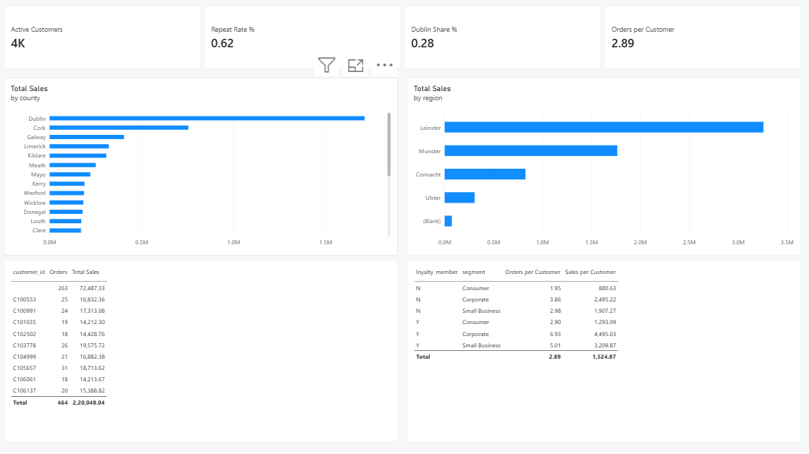
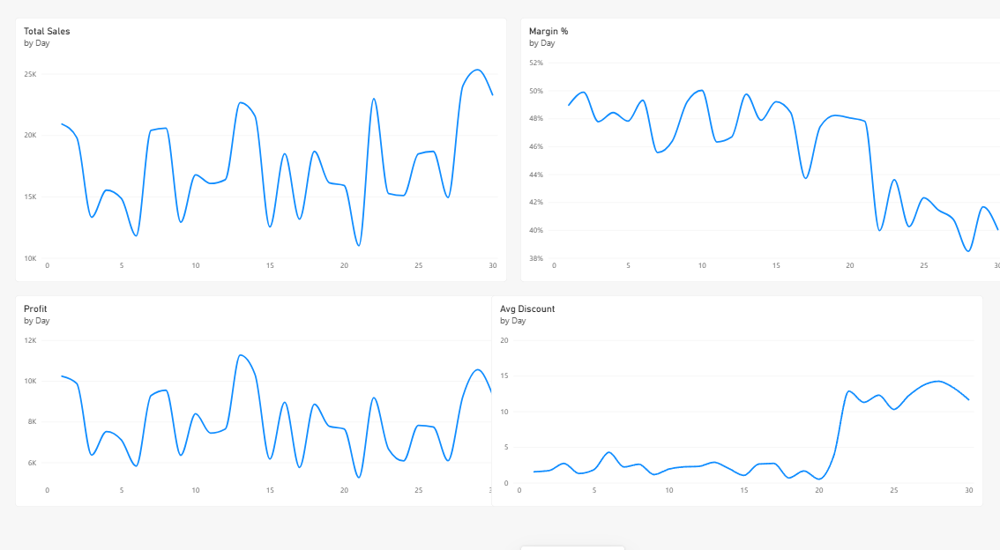

# Retail Sales Analytics: Full Report

My end to end project using Azure Data Lake, pandas and Power BI. By Obedh K Joby. The data is synthetic.

## 1. About the data and the business

The data is for Emerald Home & Living, a fictional Irish home and lifestyle retailer. The domain is retail sales, e-commerce and customer analytics. The company sells home products such as Home Decor, Kitchen, Furniture, Garden, Bedding and Lighting, both online and in stores, to consumers, small businesses and corporate customers across Irish counties. Everything is synthetic, so there are no real people, companies or transactions.

| Item | Detail |
| --- | --- |
| Business | Irish home and lifestyle retailer (fictional) |
| Domain | Retail sales, e-commerce and customer analytics |
| Period | 1 January 2024 to 30 September 2026 (2026 is a partial year) |
| Size | About 21,900 raw order lines, about 11,800 orders, 6,500 customers, 78 products |
| Currency | Euro |
| Channels | Online and store |
| Customer segments | Consumer, Small Business, Corporate |
| Payment methods | Card, PayPal, Klarna, Bank Transfer |

The business wants to understand how sales and profit change over time, which products and customers matter most, whether discounts help or hurt profit, and how returns and Black Friday affect results.

## 2. Project goal

I wanted to take three messy CSV files and turn them into a dashboard someone could actually make decisions from. I did every step myself: clean the data, store it, model it, build the visuals and write the recommendations.

## 3. Architecture

I cleaned the raw CSVs in pandas and stored them in Azure Data Lake Gen2 (container retailsales, folder cleaneddata). Then I built a star schema in Power BI and made a four page dashboard on top of it.

## 4. Source data

I worked with three files: raw orders (one row per product on an order), a product list (category, sub category, list price, unit cost) and customers (segment, county, region, signup date, loyalty flag, about 6,500 customers). Orders run from January 2024 to September 2026, and 2026 is not a full year.

## 5. Data cleaning (pandas)

| Problem | Fix |
| --- | --- |
| Three different date formats | Parsed each format and combined the results |
| Sales amounts stored as text with euro signs and commas | Stripped symbols and converted to numbers |
| Inconsistent channel labels | Standardised to online and store |
| Negative quantities and quantities off by a factor of 100 | Absolute value and scaling correction |
| Zero unit prices | Filled from the product list price |
| Missing discount | Derived from sales, quantity and price |
| Missing payment method and customer ID | Labelled Unknown so the sales are kept |
| Duplicate order lines | Removed by line ID |
| Future dated rows | Replaced with the previous order's date |
| Messy county names and missing regions | Standardised names and filled region from a county lookup |

## 6. Data model

I built a star schema with the order table in the middle. Product and customer each connect to it one to many, on product_id and customer_id.

In the order table I created 17 DAX measures and one calculated column.

| Measure | Logic |
| --- | --- |
| Total Sales | Sum of sales amount |
| Total Cost | Sum of cost amount |
| Profit | Total Sales minus Total Cost |
| Margin % | Profit divided by Total Sales |
| Orders | Distinct count of order ID |
| Order Lines | Count of order rows |
| Avg Order Value | Total Sales divided by Orders |
| Avg Discount | Average discount percentage |
| Returned Sales | Sales on returned lines |
| Return Rate % | Returned Sales divided by Total Sales |
| Online Share % | Online sales divided by Total Sales |
| Dublin Share % | Sales from Dublin customers divided by Total Sales |
| Active Customers | Distinct customers, excluding unknown |
| Repeat Customers | Customers with more than one order |
| Repeat Rate % | Repeat Customers divided by Active Customers |
| Orders per Customer | Orders divided by Active Customers |
| Sales per Customer | Total Sales divided by Active Customers |

The calculated column is Discount Band, which I used to group discount into 0%, 1 to 10%, 11 to 20%, 21 to 30% and 31%+.

## 7. Dashboard

I built four pages to answer ten business questions.

**Performance:** monthly sales and profit, seasonality, year comparison and online vs store mix.

**Products:** category and sub category revenue and profit, discount impact on margin, and returns.

**Customers:** counties and regions, best customers, repeat buyers, and loyalty vs non members.

**Black Friday:** daily sales, margin, profit and discount across November.

## 8. Key findings

- **Discounts hurt margin.** The higher the discount band, the lower the margin, and it is lowest above 30%.
- **Black Friday was heavily discounted for little extra profit.** From day 22 of November the average discount went from about 2% to about 12%. Sales went up, but margin dropped from about 48% to about 40% and daily profit stayed about the same.
- **Returns are concentrated.** Furniture has the highest return rate, then Bedding.

## 9. Recommendations

1. I would cap normal discounts at around 20% to protect margin.
2. I would run a shorter, lighter Black Friday promotion on selected products only.
3. I would look into why Furniture and Bedding get returned so much, for example product quality, descriptions and delivery damage.

## 10. Skills I used

Python (pandas) data cleaning, Azure Data Lake Storage Gen2, star schema modelling, DAX measures and calculated columns, Power BI report design, and turning analysis into business recommendations.
